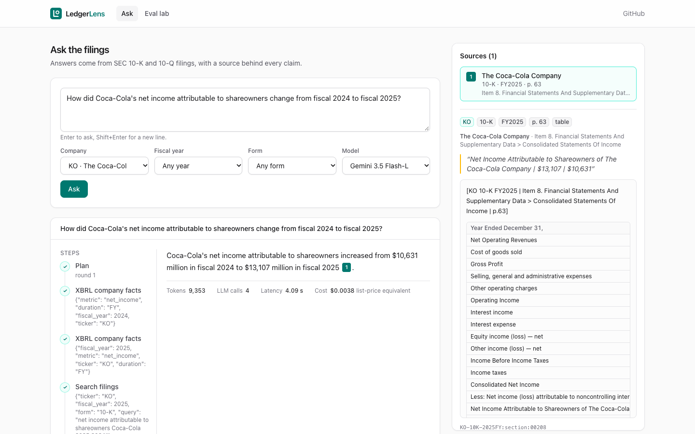
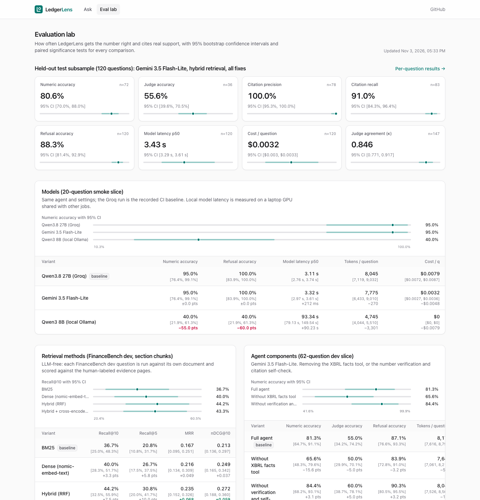
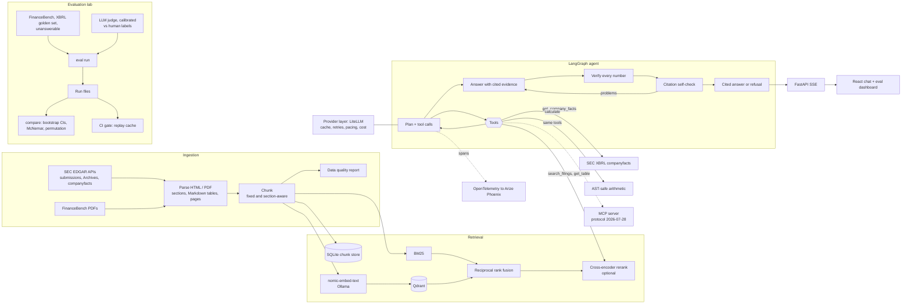

# LedgerLens

**An agentic research analyst for SEC filings that cites a source for every claim, and an evaluation lab that measures how good it is.**

Ask a question about a US public company ("How much did Coca-Cola's net income change in 2025, and why?") and LedgerLens plans, searches 10-K and 10-Q filings with hybrid retrieval, pulls exact reported numbers from the SEC's XBRL data, does arithmetic with a safe calculator, and answers with inline citations to the filing, section and page. Every number in the answer must appear in a source or the agent refuses. The evaluation lab is the core of the project: three datasets (human-labeled FinanceBench, an XBRL golden set generated from the filers' own structured data, and unanswerable questions), an LLM judge calibrated against human labels, bootstrap confidence intervals and paired significance tests on every comparison, ablations of each retrieval and agent technique, an error taxonomy with targeted fixes, and a CI gate that replays a recorded eval on every pull request and fails on regressions. Built entirely on free tiers (Gemini, Groq, local Ollama).





*Top: a real answer: two XBRL lookups and a filing search, an answer whose number is verified against the sources, and the cited passage (Coca-Cola 10-K, income statement, page 63) open in the sources panel. 4 LLM calls, 9.4k tokens, $0.0038 at list price. Bottom: the eval dashboard, built from the committed run files.*

**Live dashboard:** [rishikavootkur.github.io/ledgerlens](https://rishikavootkur.github.io/ledgerlens/) (static copy of the eval dashboard, rebuilt from the committed run files)

## Headline results

Final agent on Gemini 3.5 Flash-Lite, run once on a held-out test subsample of 120 questions (60 XBRL, 36 FinanceBench, 24 unanswerable, stratified by question type) after all development was done on dev questions. 95% intervals: Wilson for rates, bootstrap otherwise.

| Metric | Value [95% CI] | n |
|---|---|---|
| Numeric accuracy (XBRL + FinanceBench numeric) | 80.6% [70.0%, 88.0%] | 72 |
| Judge accuracy (FinanceBench, calibrated judge) | 55.6% [39.6%, 70.5%] | 36 |
| Refusal accuracy on unanswerable questions (no hallucinated answer) | 100.0% [86.2%, 100.0%] | 24 |
| Refusal accuracy, all questions (also counts false refusals) | 88.3% [81.4%, 92.9%] | 120 |
| Citation precision (cited source states the answer's numbers) | 100.0% [95.3%, 100.0%] | 78 |
| Citation recall (labeled evidence cited) | 91.0% [84.3%, 96.4%] | 83 |
| Model latency p50 | 3.4 s | 120 |
| Cost per question (list-price equivalent) | $0.0032 | 120 |

The main weakness is visible in the second refusal row: the agent never answered an unanswerable question, but it refused 31% of answerable FinanceBench questions (see error analysis).

| Evaluation-lab check | Result |
|---|---|
| LLM judge vs FinanceBench human labels (held-out, n=147, 3 labels) | 89.8% agreement [83.8, 93.7], Cohen's kappa 0.846 [0.771, 0.917], judge error rate 10.2% |
| Same, on the 52 items never read while tuning the judge prompt | 86.5% agreement [74.7, 93.3], kappa 0.788 [0.631, 0.912] |
| XBRL golden set gold values re-derived independently from SEC data | 350 of 350 match |
| CI regression gate | replays a recorded 30-question slice on every PR, no keys or network; fails on any metric drop and comments the diff |

## Architecture



## Ablations

Development numbers on fixed dev questions; the held-out test split was run only once, for the headline above. Deltas are paired comparisons on the same questions (exact McNemar for 0/1 metrics, sign-flip permutation otherwise, Holm-corrected).

**Retrieval method** (LLM-free, 60 FinanceBench dev questions, search within the question's document, scored against human-labeled evidence pages):

| Method | Recall@5 | Recall@10 | MRR | nDCG@10 |
|---|---|---|---|---|
| BM25 | 0.208 | 0.367 | 0.167 | 0.213 |
| Dense (nomic-embed-text) | 0.267 | 0.400 | 0.216 | 0.249 |
| **Hybrid, reciprocal rank fusion** | **0.308** | **0.442** | **0.235** | **0.272** |
| Hybrid + MiniLM cross-encoder rerank | 0.292 | 0.433 | 0.219 | 0.262 |

Hybrid beats BM25 on MRR by +0.068 (95% CI +0.032 to +0.109, Holm p = 0.001) and nDCG@10 by +0.059 (p = 0.001). Hybrid vs dense (+0.04 recall@10, Holm p = 1.0) and the reranker (no gain) are within noise at this sample size.

**Chunking strategy** (same setup): fixed 512-token chunks score a little higher than section- and table-aware chunks (hybrid recall@10 0.492 vs 0.442, MRR 0.286 vs 0.235), but no difference is significant (Holm p ≥ 0.9). Fixed chunks are about twice as long on average (511 vs 248 tokens), so each hit covers more of a labeled page; section chunks give the answer step cleaner, self-contained tables.

**Agent components** (62-question dev slice: 24 XBRL, 20 FinanceBench, 18 unanswerable; Gemini 3.5 Flash-Lite):

| Configuration | Numeric accuracy | Judge accuracy (FinanceBench) | Refusal accuracy | Tokens / question |
|---|---|---|---|---|
| Full agent | **0.812** [0.65, 0.91] | 0.550 [0.34, 0.74] | 0.871 [0.77, 0.93] | 8,170 |
| Without the XBRL facts tool | 0.656 [0.48, 0.80] | 0.500 | 0.839 | 7,642 |
| Without number verification and citation self-check | 0.844 [0.68, 0.93] | 0.600 | 0.903 | 8,040 |

Removing the XBRL facts tool cost 15.6 points of numeric accuracy (paired 95% CI for the gain: 3.1 to 28.1 points), the largest effect in the agent ablations, but with 32 numeric questions it is not significant after Holm correction (McNemar p = 0.06 raw, 0.44 adjusted), so treat it as a strong signal rather than an established result. The verification layer is a deliberate trade: it guarantees every number in an answer traces to a source, and on this slice it cost one numeric answer (3.1 points), one FinanceBench answer (5.0 points) and 3.2 points of refusal accuracy, without changing the hallucination rate on unanswerable questions (0.889 either way). None of these agent-level differences is significant at this sample size; the slice is sized to free-tier quotas, not to statistical power.

## Model comparison

Same agent and settings on the 20-question smoke slice (AAPL, JPM, KO XBRL questions):

| Model | Numeric accuracy | Refusal accuracy | Model latency p50 | Tokens / question | List-price cost / question |
|---|---|---|---|---|---|
| Qwen3.8 27B (Groq) | 0.950 [0.76, 0.99] | 1.000 | 3.1 s | 8,045 | $0.0079 |
| Gemini 3.5 Flash-Lite | 0.950 [0.76, 0.99] | 1.000 | 3.3 s | 7,775 | $0.0032 |
| Qwen3 8B (local Ollama) | 0.400 [0.22, 0.61] | 0.400 | 93 s* | 4,744 | $0 (self-hosted) |

The local 8B model is significantly worse (−55 points, Holm p = 0.007): it refuses 60% of answerable questions. Flash-Lite matches the 27B model at 40% of its list-price cost. *Local latency was measured on a laptop GPU shared with the embedding job.

## Error analysis

Every failed question is sorted into a taxonomy by `ledgerlens eval analyze` (rule-based, auditable, no model calls; categories are written into the run files and shown on the dashboard):

| Category | Held-out test (23 of 120 failed) | Dev slice (13 of 62 failed) | What it looks like |
|---|---|---|---|
| Bad refusal | 14 | 8 | mostly refusing answerable FinanceBench questions; on dev, two are unanswerable "old period" questions the agent answered from XBRL history beyond the ingested filings (a dataset/tool scope mismatch, decision D20) |
| Retrieval miss | 5 | 1 | the labeled evidence page never reached the agent |
| Arithmetic | 3 | 2 | year-over-year change computed from the wrong pair of facts |
| Table misread | 1 | 2 | the right page was retrieved but another cell was used |

False refusals on FinanceBench are the largest remaining problem: the verifier and self-check refuse when the model's numbers or quotes cannot be matched to the PDF text, which is noisier than EDGAR HTML. Loosening that safely is the next fix.

Three targeted fixes came out of reading the dev failures. Each sits behind a flag, so its effect is a paired, replayable comparison on the 62-question dev slice (none is individually significant at this size):

| Fix | What was wrong | Effect when the fix is removed |
|---|---|---|
| 1. Skip repeated tool calls | models re-issued the same XBRL lookup every planning round | +0.6% tokens on Flash-Lite, no accuracy change (it mattered more on Groq Qwen, where repeats ate the 8k tokens/minute budget) |
| 2. Accept derived numbers | the verifier refused correct answers whose ratio the model computed itself | numeric −3.1, FinanceBench judge −5.0, refusal accuracy −3.2 points |
| 3. Split grouped citation markers | `[E1, E4]` looked like no citation and forced a refusal | numeric −9.4, judge −5.0, refusal accuracy −6.5 points |

Fix 2 needed a second iteration: the first version accepted any number one arithmetic step away from any evidence number, and a measurement showed it would accept 99% of invented numbers. It now derives only from inputs the answer states (or single-value XBRL facts it cites), with a tolerance set by the digits written: under 1% false acceptance in a 2,000-trial test. On recorded Groq Qwen answers the fixes also lifted the CI slice from 0.90 to 0.95 numeric accuracy.

## Run it in five commands

```bash
git clone https://github.com/RishikaVootkur/ledgerlens && cd ledgerlens
cp .env.example .env            # add free GEMINI_API_KEY, GROQ_API_KEY and your SEC_USER_AGENT
make setup                      # uv sync, npm ci, ollama pull nomic-embed-text
docker compose up -d qdrant phoenix && uv run ledgerlens ingest run --tickers AAPL,JPM,KO --no-financebench && uv run ledgerlens index build
make up                         # adds the API and UI; open http://127.0.0.1:8080
```

`make ingest` builds the full corpus (30 companies plus the FinanceBench documents). Other entry points: `uv run ledgerlens ask "..."`, `uv run ledgerlens eval run --config eval/configs/default.yaml --split dev`, `uv run ledgerlens eval compare <runA> <runB>`, and `uv run ledgerlens mcp serve` for MCP clients ([docs/mcp.md](docs/mcp.md)).

## How the evaluation works

See [docs/eval-methodology.md](docs/eval-methodology.md). In short: fixed dev and test splits, the test split reported once; numeric answers scored against tolerance with no forgiveness for scale errors; free-text answers scored by a judge from a different model family than the answer model, calibrated against FinanceBench's human labels; Wilson and bootstrap 95% intervals; paired McNemar and permutation tests with Holm correction; every LLM and tool response cached so reruns are free and CI replays them deterministically.

## Data and licenses

- Code: MIT ([LICENSE](LICENSE)).
- SEC EDGAR filings and XBRL data are public. Requests identify themselves with a User-Agent and stay under SEC's 10 requests per second.
- FinanceBench (questions, answers, evidence, and the published model answers with human labels used for judge calibration) is © Patronus AI, CC BY-NC 4.0: Islam et al., 2023, "FinanceBench: A New Benchmark for Financial Question Answering". This project is non-commercial.
- Datasheets: [eval/datasets/](eval/datasets/). Design decisions: [docs/decisions.md](docs/decisions.md).

## What I learned

- **Measure the evaluator before trusting it.** My first judge prompt agreed with human labels only 75% of the time; the disagreements were all about what counts as a refusal. One rule change took it to 90%, and splitting the calibration set by question (not by answer) kept that number honest.
- **A safety check can quietly switch itself off.** The derived-number fix looked like a free win until I measured how often it accepted random numbers. Writing that measurement as a test is what keeps it fixed.
- **Score the scorer.** Two of the biggest metric moves in this project were scorer bugs, not model changes: the model returned numbers as strings, and occasionally wrote a full number while also naming a scale. Replaying cached responses made those fixes free to verify.
- **Free tiers shape the experiment design.** Groq allows 200k tokens a day per model and Gemini 3.8 Flash 20 requests a day, so every call is cached, ablations run on the model with the most headroom, and finished runs can be re-scored without spending quota.
- **Small evals need honest statistics.** At 62 questions only big effects are significant; reporting intervals and Holm-corrected p-values next to every delta keeps the claims proportional.
